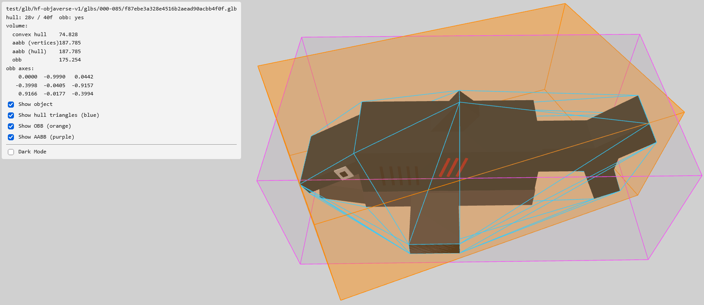

# minobb



[[GitHub: juj/minobb]](https://github.com/juj/minobb)

This repository contains C++ code for calculating the minimum enclosing oriented bounding box (OBB) by volume for 3D polyhedra.

# Quick Getting Started

Copy the files `minobb.h`, `minobb.cpp`, `convex_hull.h` and `convex_hull.cpp` to your project. Then

```c++
#include "minobb.h"
#include <stdio.h>

int main()
{
	// Input points
	float points[] = { 0,0,0,  4,1,0,  1,3,0,  2,2,5,  5,4,1,  0,1,4 };
	int strideBytes = 3 * sizeof(float);
	int numPoints = sizeof(points) / strideBytes;

	Hull3 hull = convex_hull(points, numPoints, strideBytes);
	OBB obb = minobb(hull);

	printf("center:       %g %g %g\n", obb.pos.x, obb.pos.y, obb.pos.z);
	printf("half extents: %g %g %g\n", obb.r.x, obb.r.y, obb.r.z);
	for (int i = 0; i < 3; ++i)
		printf("axis %d:       %g %g %g\n", i, obb.axis[i].x, obb.axis[i].y, obb.axis[i].z);
	printf("volume:       %g\n", obb.Volume());
}
```

```
c++ -O2 -std=c++17 example.cpp minobb.cpp convex_hull.cpp -o example
```

The above program computes the minimum volume OBB for the given point set. As a necessary intermediate step, the convex hull of the object needs to be computed. Adjust the `tolerance` parameter of `minobb()` to control the precision-vs-speed tradeoff. Pass `tolerance=0` to compute the exact box. For spherical and cylindrical shapes with hundreds of thousands of vertices, this can take several minutes. By default `tolerance=0.0015`, to quickly produce an OBB that is at most 0.15% larger than the minimum.

The box is returned as its center `pos`, its half extents `r` and its three orthonormal axes `axis[0..2]`: a point `p` is inside the OBB if `|dot(axis[i], p - pos)| <= r[i]` for each `i`.

## Online Calculator

To quickly compute the minimal OBB for a given GLTF/GLB file, open the [online viewer](https://juj.github.io/minobb/site/view.html), and then drag-n-drop your GLTF file to it. The page will then compute the minimum volume OBB for you.

The page draws the model with its convex hull, its OBB and its axis-aligned bounding box, and shows the boxes as JSON (in the format of the command line tool below) in a text box, with a `Copy JSON` button under it. A `.gltf` file needs its `.bin` and texture files dropped with it: drop them all at once, or drop the folder that has them. The `tolerance` can be set on the page.

The calculation runs in your browser, the model is not uploaded anywhere. The calculator of the page is the code of this repository compiled to WebAssembly: `python build_viewer.py` builds it into `site/calculator.js` (requires `em++` of [Emscripten](https://emscripten.org) on the path).

## Command Line Tool

If you would like to have a command line tool that computes the minimum volume OBB of a glTF file, build `minobb_glb`:

```
c++ -O3 -std=c++17 -I. -o minobb_glb minobb.cpp convex_hull.cpp glb.cpp test/minobb_glb.cpp
minobb_glb model.glb > model.json
```

(Or with CMake: `cmake -B build` and `cmake --build build --config Release`.)

This generates a JSON file with the convex hull (vertices and faces), the OBB (center, half extents, axes and volume), the axis-aligned bounding boxes, and the times that the hull and the OBB took to compute. The tool reads `.glb` files, and `.gltf` files with embedded or external buffers. It takes the vertex positions of all the meshes of the default scene, in world space; skinned meshes are posed by their joints as the file has them. Animations and morph targets are not applied, and Draco or meshopt compressed and sparse position data is not supported.

# The Algorithm

The code in this repository utilizes my research on minimum OBB computation from 2015: [An Exact Algorithm for Finding Minimum Oriented Bounding Boxes](https://juj.github.io/minobb/site/minobb_jylanki_2015_06_01.pdf).

The main idea of the algorithm is the observation that the minimum volume OBB is spanned by three distinct edge-face contacts of the polyhedron and the OBB. The algorithm enumerates combinations of such edge-face contacts quickly to find the minimum one. These combinations fall into distinct category classes. See [the contact categories A–D](https://juj.github.io/minobb/site/cases.html) for an example polyhedron of each.

On top of the enumeration of the paper, the implementation skips edges and directions that cannot lead to a smaller box than the best one found so far. With a `tolerance`, it also skips searching edge configurations that cannot improve the volume by more than the given tolerance.

In the original publication, the optimality of the algorithm was not yet proven. With help from Claude Fable 5.2, the algorithm has now been proven to be optimal, and formalized in Lean.

# Proof of Optimality

The paper conjectured that a box of minimal volume around a convex polyhedron has at least three distinct edge-face contacts with it, at least two of them on adjacent faces of the box (Conjecture 7.1). The proof is written up in [A proof of the three-contact conjecture for minimum-volume bounding boxes](https://juj.github.io/minobb/site/proof.html).

## Lean Formalization

The proof has been formalized by Claude Fable 5.2 in Lean 4, with Mathlib. The Lean proof can be found in the directory [lean/](lean/), with its own [README](lean/README.md) that lists the main theorems and how the files follow the written proof.

For a walkthrough of the Lean proof, check out [The Lean proof, step by step](https://juj.github.io/minobb/site/lean-walkthrough.html).

### Running the Lean proof yourself

Install [elan](https://lean-lang.org/install/), the Lean toolchain manager (`lean/lean-toolchain`). Then

```
cd lean
lake exe cache get          # once: fetches a prebuilt Mathlib
lake build                  # checks the proof
lake env lean Verify.lean   # prints the statements of the main theorems and the axioms they depend on
```

`lake build` succeeding means that Lean accepted every proof. The last command should list only the three standard axioms `propext`, `Classical.choice` and `Quot.sound` for each theorem, and no `sorryAx`.

# Testing

The algorithm has been tested on 6,933 glTF models from the [Objaverse](https://objaverse.allenai.org/) data set, of up to 15 million vertices each, with convex hulls of up to 323,658 vertices. For every model, the box of `minobb()` is compared with the result of an exhaustive search in double precision: with `tolerance=0` the results have been confirmed to be equal.

[The test results](https://juj.github.io/minobb/site/results.html) show the computation times of the convex hull and of the OBB for each model in the test set. With the default tolerance, the OBB of a typical model takes half a millisecond for a hull of under 100 vertices, 3 milliseconds for one of hundreds of vertices, and 20 milliseconds for one of thousands, on one thread of a desktop CPU. The slowest model of the data set takes 5 seconds.

## Running tests

The tests require Python 3 and `clang++` on the path.

Run

```
python test.py
```

to check through the whole test suite. This includes:

- the examples of the paper (`test/testobb.cpp`),
- two regression tests (`test/repro_minimal.cpp`, `test/contcheck.cpp`), and
- the three tests below, which go through all models that are downloaded under `test/glb`.

The three main tests can also be run on their own:

- `python test_convex_hull.py` verifies the convex hull of every model. A report is output to `convex_hull_report/`.
- `python test_minobb.py` checks computed OBBs against an exhaustive reference search. The exhaustive search is slow, so results are cached next to the models (`<name>.gt.json`) to avoid recomputation later.
- `python test/test_glb.py` recomputes the hull and the OBB of every model and compares their volumes with the stored results (`<name>.json`).

The models are not part of the repository. To get them:

```
pip install objaverse
python download_glb.py 1000      # downloads 1000 random models into test/glb; run again for more
python calculate_obb.py          # computes <name>.json for every model, with test/minobb_glb.cpp
python build_index.py            # writes site/glb.html and site/results.html
```

To browse downloaded models with their computed hulls and boxes, serve the repository root with `python -m http.server` and open `http://localhost:8000/site/glb.html`.
